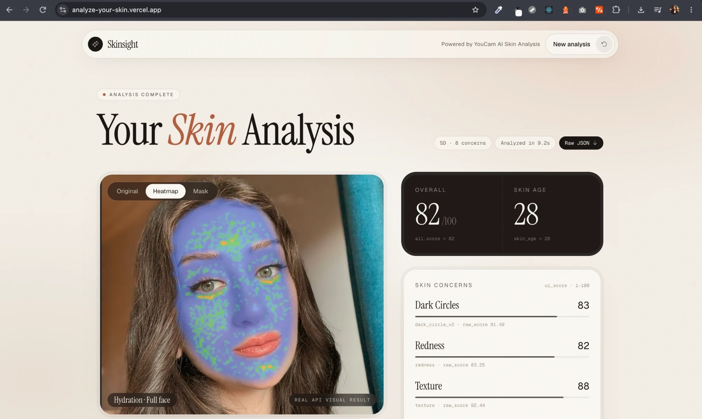
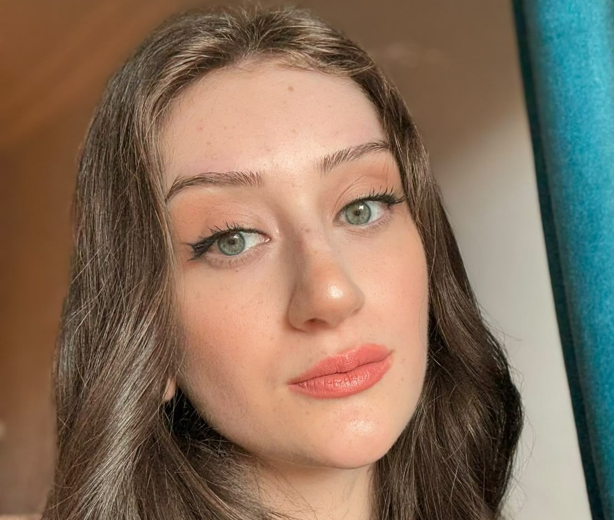
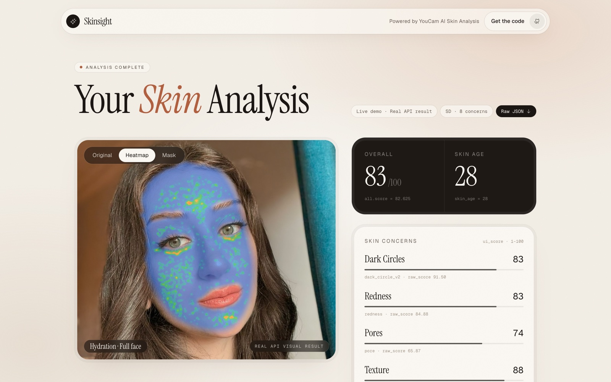
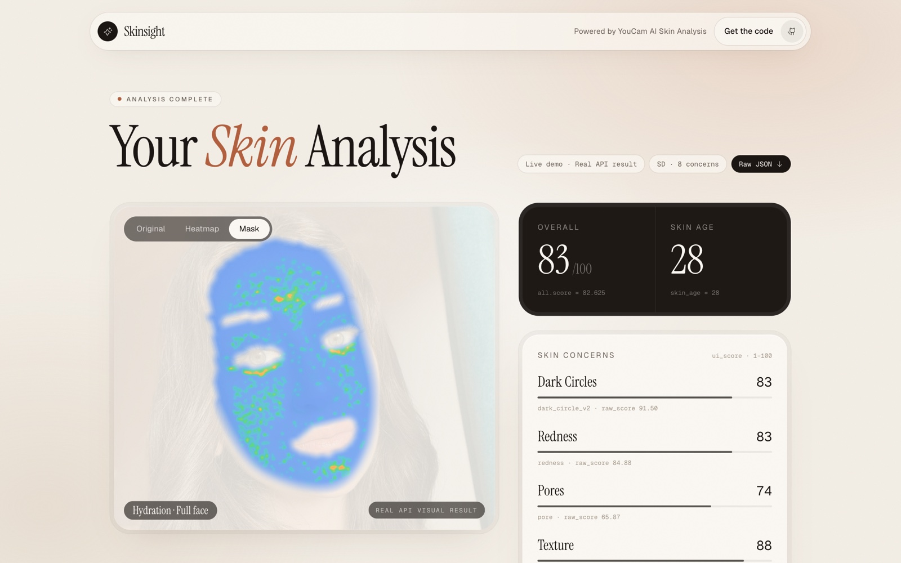
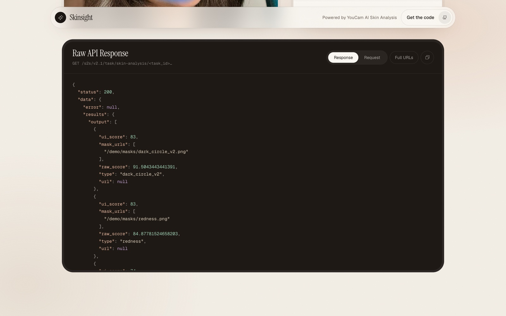

# Skinsight

Build your own AI skin analysis website without training a model.

This is a complete Next.js app. You add a [YouCam](https://yce.perfectcorp.com/ai-api) API key, upload a selfie, and get skin scores, skin age, heatmaps, masks and the raw JSON response.

Live demo: [analyze-your-skin.vercel.app](https://analyze-your-skin.vercel.app)

The live demo replays one saved, real result and photo uploads are turned off there. Run this repo with your own API key to get the full app.

Türkçe anlatım için [aşağıya bakın](#türkçe).



| Selfie | Heatmap | Mask |
| --- | --- | --- |
|  |  |  |

## Why you don't need to train a model

Training your own skin model means collecting and labeling a huge image dataset and spending months on training. General chat models are not built for this either: they can describe a photo, but they don't return repeatable measurements.

The YouCam API gives you that model as a ready service. According to YouCam, it was trained on over 70,000 medical-grade images. You send a photo and get structured results back, so your work is the product around it.

## What you get

- Scores for texture, pores, redness, dark circles, wrinkles, hydration, radiance and oiliness
- An overall score and a skin age
- Heatmap and mask overlays that show where each concern is on the face
- The raw JSON request and response next to the interface, which is useful when you build on top of it
- A consent step and a privacy notice page you can adapt

Every score and visual on screen comes directly from the API response. Nothing is calculated or invented in the app.

> Cosmetic skin analysis for informational purposes. This is not a medical diagnosis.

## Setup

You need Node.js 20 or newer and a YouCam API account.

### 1. Get free API units

Sign up and use the redeem code `ytyildiz` to get 500 free API units:
[yce.perfectcorp.com/api-console/en/redeem-code](https://yce.perfectcorp.com/api-console/en/redeem-code/)

### 2. Create an API key

Open the [API keys page](https://yce.perfectcorp.com/api-console/en/api-keys/) and generate a new key. You can give it an expiry date or make it permanent.

Treat this key like a password. Don't share it, don't commit it, and don't paste it into a chat.

### 3. Download the project

```bash
git clone https://github.com/YildizDikme/skinsight.git
cd skinsight
npm install
```

### 4. Add your key

```bash
cp .env.example .env.local
```

Open `.env.local` and paste your key:

```
YOUCAM_API_KEY=your_key_here
```

`.env.local` is ignored by git, so your key stays on your machine.

### 5. Run it

```bash
npm run dev
```

Open [http://localhost:3000](http://localhost:3000), drop in a selfie, accept the consent checkbox and start the analysis.

## Using the results



- Switch between Original, Heatmap and Mask on the photo.
- Click a concern to see its overlay.
- Scroll down to the raw JSON to see exactly what was sent and returned.

For the best results:

- Use a close, front-facing photo. Your face should fill more than 60% of the width.
- Use even, bright light.
- Take off your glasses and keep bangs off your forehead.

The browser resizes photos to 2560px at most. It picks HD analysis when the short side is at least 1080px, and SD analysis otherwise. The short side must be at least 480px.

## How it works

```
Selfie ──▶ /api/analyze ──▶ YouCam File API (upload)
                         └─▶ POST /s2s/v2.1/task/skin-analysis
Browser ◀── polls /api/analyze/[taskId] ◀── GET /s2s/v2.1/task/skin-analysis/{task_id}
```

The API key stays on the server. The browser only receives the task id and the results. Masks returned by the API are layered on top of the original photo.

| Path | What it does |
| --- | --- |
| `app/api/analyze/route.ts` | Uploads the photo and creates the analysis task |
| `app/api/analyze/[taskId]/route.ts` | Returns the task status and result |
| `lib/youcam.ts` | Calls the YouCam API with your key, server side only |
| `lib/skin.ts` | Lists the requested concerns and parses the response |
| `lib/image.ts` | Prepares the photo in the browser |
| `components/` | The interface: upload, loading state, results and raw JSON |
| `app/privacy/page.tsx` | Privacy notice template |

To request different concerns, edit `DST_ACTIONS` in `lib/skin.ts`.

### Using it with Claude

`.mcp.json` connects Claude Code and other MCP tools to the YouCam MCP server, which exposes the YouCam tools and schemas during development. It reads the same `YOUCAM_API_KEY`, so set the key in your shell before you start your tool. There is no key in the file.

## Deploying

1. Push your copy to your own GitHub repository.
2. Import it on [Vercel](https://vercel.com).
3. Add `YOUCAM_API_KEY` under Project Settings, Environment Variables.
4. Deploy.

Before you make it public:

- Every analysis uses your API units, and anyone who can open the site can spend them. Add a login or rate limiting, or keep the site private.
- Faces are sensitive personal data. Get explicit consent before you send a photo, and follow the laws where you operate, such as GDPR in the EU and KVKK in Turkey.
- Replace the name and email at the top of `app/privacy/page.tsx`, and have the text reviewed for your own product. It is a starting point, not legal advice.
- Show scores only. Don't present results as medical advice.

## Troubleshooting

| Message | What to do |
| --- | --- |
| `YOUCAM_API_KEY is not set` | Check `.env.local`, then restart `npm run dev` |
| `error_src_face_too_small` | Use a closer photo |
| `error_src_face_out_of_bound` | Center your face in the frame |
| `error_lighting_dark` | Use a brighter photo |
| `error_below_min_image_size` | Use a larger photo |
| `CreditInsufficiency` | Add API units to your account |

## Stack

- [Next.js](https://nextjs.org) (App Router) and TypeScript
- Tailwind CSS
- YouCam AI Skin Analysis REST API (v2.1)

---

## Türkçe

Model eğitmeden kendi yapay zeka cilt analizi sitenizi kurun.

Bu, hazır bir Next.js uygulaması. Kendi YouCam API anahtarınızı ekliyorsunuz, bir selfie yüklüyorsunuz ve cilt skorlarını, cilt yaşını, ısı haritalarını, maskeleri ve ham JSON yanıtını alıyorsunuz.

[Canlı demo](https://analyze-your-skin.vercel.app) tek bir gerçek sonucu gösterir, orada fotoğraf yükleme kapalıdır. Uygulamanın tamamı için bu repoyu kendi anahtarınızla çalıştırın.

### Neden model eğitmeniz gerekmiyor?

Kendi cilt modelinizi eğitmek için çok büyük bir görsel veri seti toplamanız, etiketlemeniz ve aylarca eğitim yapmanız gerekir. ChatGPT veya Claude gibi genel modeller de bu iş için yapılmadı: fotoğrafı yorumlayabilirler ama tekrarlanabilir ölçüm vermezler.

YouCam API bu modeli hazır bir servis olarak sunuyor. YouCam'in paylaştığı bilgilere göre model 70.000'den fazla tıbbi nitelikte görselle eğitildi. Siz fotoğrafı gönderiyorsunuz, yapılandırılmış sonucu alıyorsunuz. Size de ürünü geliştirmek kalıyor.

### Kurulum

Node.js 20 veya üzeri ve bir YouCam API hesabı gerekiyor.

1. Üye olun ve `ytyildiz` koduyla 500 ücretsiz API kredisi alın: [kodu kullanma sayfası](https://yce.perfectcorp.com/api-console/en/redeem-code/)
2. [API anahtarları sayfasından](https://yce.perfectcorp.com/api-console/en/api-keys/) yeni bir anahtar oluşturun. Bu anahtarı kimseyle paylaşmayın.
3. Projeyi indirin ve paketleri kurun:

   ```bash
   git clone https://github.com/YildizDikme/skinsight.git
   cd skinsight
   npm install
   ```

4. Ortam dosyasını oluşturun:

   ```bash
   cp .env.example .env.local
   ```

5. `.env.local` dosyasını açıp anahtarınızı yapıştırın:

   ```
   YOUCAM_API_KEY=anahtariniz
   ```

6. Çalıştırın ve [http://localhost:3000](http://localhost:3000) adresini açın:

   ```bash
   npm run dev
   ```

Selfie'nizi yükleyin, açık rıza kutusunu işaretleyin ve analizi başlatın. Sonuçta fotoğraf üzerinde Original, Heatmap ve Mask görünümleri arasında geçiş yapabilir, bir cilt başlığına tıklayıp maskesini görebilir ve aşağıda ham JSON'u inceleyebilirsiniz.

En iyi sonuç için yüzünüzün yakın olduğu, karşıdan çekilmiş ve iyi ışıklı bir fotoğraf kullanın. Yüzünüz fotoğraf genişliğinin yüzde 60'ından fazlasını kaplamalı. Gözlük takmayın, perçeminiz alnınızı kapatmasın.

### Yayına almadan önce

- Her analiz API kredinizi harcar ve siteye giren herkes bu krediyi kullanabilir. Üyelik veya istek sınırı ekleyin ya da siteyi kapalı tutun.
- Yüz fotoğrafı hassas veridir. Fotoğrafı göndermeden önce kullanıcının açık rızasını alın, KVKK ve GDPR gibi geçerli yasalara uyun.
- `app/privacy/page.tsx` dosyasının başındaki ad ve e-postayı kendi bilgilerinizle değiştirin, metni kendi ürününüze göre gözden geçirin. Bu metin bir başlangıçtır, hukuki danışmanlık değildir.
- Yalnızca skor gösterin, sonuçları tıbbi öneri gibi sunmayın.

Bu uygulama bilgilendirme amaçlı kozmetik cilt analizi yapar, tıbbi teşhis değildir.
